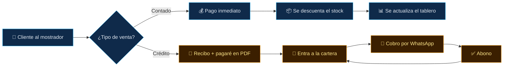

<div align="center">


**Sistema POS + Inventario para comercializadoras de insumos y reactivos químicos mineros**


</div>


## 📌 Tabla de contenidos

<div align="center">

| | | |
|:---:|:---:|:---:|
| 📖 [Acerca del proyecto](#-acerca-del-proyecto) | ✨ [Módulos principales](#-módulos-principales) | ⚡ [Flujo de una venta](#-flujo-de-una-venta) |
| 📸 [Vista previa](#-vista-previa) | 🧰 [Stack tecnológico](#-stack-tecnológico) | 💾 [Base de datos](#-base-de-datos) |
| 🚀 [Instalación](#-instalación-en-xampp) | 📂 [Estructura](#-estructura-del-proyecto) | 🧭 [Roadmap](#-roadmap) |
| 🤝 [Contribuir](#-contribuir) | 👤 [Autor](#-autor) | 📄 [Licencia](#-licencia) |

</div>

---

## 📖 Acerca del proyecto

> **MINERVOX** es una aplicación web *mobile-first* de **Punto de Venta (POS)**, diseñada a la medida para la comercialización de insumos y reactivos químicos mineros.

Centraliza las ventas de contado, el control de inventario de **sustancias controladas** y la administración de cartera (créditos o *"fiaos"*), automatizando la creación de pagarés en PDF y la comunicación con el cliente por WhatsApp.

| 🎯 Qué resuelve | Cómo lo hace |
|---|---|
| 📦 **Inventario** | Stock en tiempo real, alertas de stock mínimo y baja lógica de productos sin perder el historial |
| 🧾 **Recibos y pagarés** | Recibo térmico en PDF y pagaré con saldo y firma para las ventas a crédito |
| 💰 **Gestión de cartera** | Semáforo de vencidos / por vencer / al día, abonos validados y cobro por WhatsApp |
| 📊 **Control financiero** | Tablero con capital en inventario, dinero en caja del día y plata en la calle |
| 🗄️ **Instalación local** | XAMPP + MySQL/MariaDB, sin Node.js, npm ni proceso de compilación |
| 📱 **Mobile-first** | Interfaz ágil para vender desde el mostrador, tablet o celular |

> ℹ️ **Estado actual (noviembre 2026):** el núcleo está operativo —POS, inventario, cartera, configuración y esquema SQL—. La autenticación con roles, los gastos, las compras a proveedores y los cierres de caja están en el roadmap, **no implementados**.

<div align="center">


</div>

---

## ✨ Módulos principales

<table>
<tr>
<td width="50%">

### 🛒 Facturación dual
POS con carrito que alterna precios de **contado** y **crédito**, valida el stock en el servidor y descuenta inventario al confirmar la venta.

</td>
<td width="50%">

### 🔍 Clientes por cédula
Busca y autocompleta por **cédula/NIT**; si el cliente es nuevo, se registra sin salir de la venta. La cédula es única.

</td>
</tr>
<tr>
<td width="50%">

### 🚦 Cartera con semáforo
Plazos configurables (**8 y 15 días**), estados al día / por vencer / vencido, abonos con validación de saldo y recordatorio por **WhatsApp**.

</td>
<td width="50%">

### 📦 Inventario con alertas
Stock mínimo, alerta visual, **baja lógica** de productos (se conserva el historial) y costo congelado en cada venta.

</td>
</tr>
<tr>
<td width="50%">

### 🖨️ Recibo y pagaré
Recibo térmico en **PDF** con los datos del negocio; en crédito incluye pagaré, abono y saldo. Sin internet usa la impresión del navegador.

</td>
<td width="50%">

### ⚙️ Configuración y tablero
Datos del negocio, plazos y recargo por mora; tablero con capital en inventario, caja del día y plata en la calle.

</td>
</tr>
</table>

> 🗺️ **Roadmap:** autenticación con roles, usuarios, gastos, compras/proveedores, cierres de caja y kardex no están implementados todavía.

---

## ⚡ Flujo de una venta



---

## 📸 Vista previa

> 🎨 Maquetas ilustrativas de las tres pantallas principales — el diseño real se ajusta a cada dispositivo.

<div align="center">

**🛒 Punto de Venta**



_Alterna contado / crédito, busca al cliente por cédula y valida el stock antes de cobrar._

**🚦 Semáforo de cartera**



_Saldos al día, por vencer y vencidos, con abonos y cobro por WhatsApp en un clic._

**📄 Pagaré en PDF**



_Documento listo en segundos: datos del crédito, abono, saldo, firma y descarga en PDF._

</div>

---

## 🧰 Stack tecnológico

<div align="center">

| Capa | Tecnologías |
|:---:|:---|
| 🎨 **Frontend** |      — Tailwind vía CDN, **Vue 3** para la reactividad, diseño mobile-first y  para íconos |
| ⚙️ **Backend** |  `POO` + `PDO` — respuestas JSON, validación centralizada y transacciones en **6 endpoints** |
| 🗄️ **Base de datos** |   — **7 tablas** con claves foráneas, índices y `utf8mb4` |
| 🔐 **Seguridad** | Consultas preparadas, validación de entrada, escapado en el recibo PDF, configuración local fuera de Git y `.htaccess` para bloquear `.sql`, `.git` y respaldos |
| 📄 **Documentos** | `html2pdf.js` — recibo térmico y pagaré en PDF (con respaldo a la impresión del navegador) |
| 🖥️ **Entorno** |  Apache + PHP + MariaDB, **sin Node.js ni npm** |

</div>

---

## 🚀 Instalación en XAMPP

1. **Copia el proyecto** en `C:\xampp\htdocs\minervox-pos` (o clónalo ahí).
2. **Inicia Apache y MySQL** desde el panel de XAMPP.
3. **Crea la base de datos** importando `database.sql`:
   - phpMyAdmin → *Importar* → `database.sql`, o
   - consola: `mysql -u root < database.sql`

   El script crea `minervox_db`, las 7 tablas y la configuración inicial. Es idempotente: no borra datos existentes.
4. **Configura la conexión:** copia `api/config.example.php` como `api/config.local.php` y ajusta host, puerto, usuario y contraseña. Ese archivo está en `.gitignore`.
5. **Abre** `http://localhost/minervox-pos/`.
6. **Configura el negocio** en *Ajustes* (nombre, NIT, plazos y texto del pagaré) y crea tus productos en *Inventario*.

> 🧩 Si ya tenías datos de una versión anterior, haz un respaldo y ejecuta `database/migraciones/2026-11-17_robustez.sql`. Agrega `activo` en `productos`, `costo_unitario` en `venta_detalles` y los índices de consulta.
>
> 🌐 **Internet:** Tailwind, Vue, Font Awesome y html2pdf se cargan por CDN. Sin conexión la interfaz no renderiza bien; el modo offline completo está en el roadmap.

### Requisitos

- XAMPP con **Apache**, **PHP 8+** y **MySQL/MariaDB**.
- Extensiones `pdo_mysql` y `mbstring` habilitadas.
- Para producción local usa Apache: `php -S` **no** aplica las reglas de `.htaccess`.

---

<details>
<summary><b>🧩 Errores frecuentes</b></summary>

| Síntoma | Solución |
|---|---|
| «No se pudo conectar con la base de datos» | Verifica que MySQL esté iniciado y que `api/config.local.php` tenga el puerto, usuario y contraseña correctos |
| `PDOException: could not find driver` | Habilita la extensión `pdo_mysql` en `php.ini` y reinicia Apache |
| Error 404 al abrir la app | Confirma la carpeta en `htdocs` y entra a `http://localhost/minervox-pos/` |
| Fecha u hora desfasadas | `api/db.php` fija `America/Bogota` en PHP y `-05:00` en MySQL; revisa que no haya otra configuración de zona horaria |
| «Stock insuficiente» al vender | El stock se valida en el servidor; actualízalo manualmente desde *Inventario* antes de vender |
| No se descarga el PDF | Revisa el bloqueador de ventanas emergentes; sin internet la app usa el diálogo de impresión del navegador |

</details>

> ⚠️ Requisitos: **XAMPP** (Apache + PHP 8+ + MySQL/MariaDB) con `PDO` y `mbstring` habilitados.

---

## 📂 Estructura del proyecto

```
minervox-pos/
├── 📁 api/                             # 6 endpoints PHP + utilidades compartidas
│   ├── 📄 db.php                       # Conexión PDO (config.local.php + variables de entorno)
│   ├── 📄 config.example.php           # Plantilla de configuración local
│   ├── 📄 utilidades.php               # Validación, respuestas JSON y manejo de errores
│   ├── 📄 ventas.php  cartera.php      # Venta, abonos y cartera
│   └── 📄 productos.php  clientes.php  configuracion.php
├── 📁 assets/
│   ├── 📄 app.js                       # Lógica de la interfaz (Vue 3)
│   ├── 📄 print_templates.js           # Recibo/pagaré en PDF con escapado de datos
│   ├── 📄 styles.css  favicon.svg
│   └── 📁 readme/                      # Imágenes del README
├── 📁 database/
│   └── 📁 migraciones/                 # Cambios de esquema para instalaciones existentes
├── 📄 database.sql                     # Esquema base (7 tablas) idempotente
├── 📄 .htaccess                        # Protección de Apache (XAMPP)
├── 📄 .gitignore                       # Credenciales, logs y respaldos
├── 📄 index.html                       # Punto de entrada de la aplicación
├── 📄 LICENSE  README.md
```

> ⚠️ `index1.html` y el archivo `Pagina Web` son restos de versiones anteriores; no hacen parte de la aplicación actual.

<details>
<summary><b>📡 Referencia rápida de la API</b></summary>

| Archivo | Responsabilidad |
|---|---|
| `productos.php` | Listado, alta, edición y baja lógica de productos; valida precios, stock y stock mínimo |
| `clientes.php` | Búsqueda por cédula/NIT y alta de clientes (cédula única) |
| `ventas.php` | Registra la venta, valida stock, recalcula totales, congela el costo y crea el crédito si aplica |
| `cartera.php` | Tablero financiero, semáforo de créditos y registro de abonos con bloqueo por saldo |
| `configuracion.php` | Datos del negocio, plazos y recargo por mora (fila única `id = 1`) |
| `db.php` | Conexión PDO; lee `config.local.php` y variables de entorno |
| `utilidades.php` | Validación de campos, respuestas JSON y manejo uniforme de errores |

**Códigos de respuesta:** `200/201` éxito, `400` JSON inválido, `404` recurso inexistente, `405` método no permitido, `409` conflicto (cédula duplicada, crédito ya pagado), `422` datos inválidos y `500` error interno sin detalles SQL.

</details>

---

## 💾 Base de datos

`database.sql` crea `minervox_db` con **7 tablas**:

| Tabla | Contenido |
|---|---|
| `configuracion` | Fila única (`id = 1`) con datos del negocio, plazos y texto del pagaré |
| `productos` | Catálogo, precios, stock, stock mínimo y baja lógica (`activo`) |
| `clientes` | Cédula única, nombre, teléfono y ubicación |
| `ventas` | Cabecera: tipo (contado/crédito), total, cliente y fecha |
| `venta_detalles` | Líneas con cantidad, precio y **costo congelado** |
| `cartera_creditos` | Saldo, fecha de vencimiento y estado del crédito |
| `abonos` | Pagos parciales y abono inicial asociados a un crédito |

Las relaciones usan claves foráneas (`ventas → clientes`, `venta_detalles → ventas/productos`, `cartera_creditos → ventas`, `abonos → cartera_creditos`) e índices en fechas, estados y cédula.

---

## 🔐 Notas de seguridad

- Las credenciales viven en `api/config.local.php` (ignorado por Git) o en variables de entorno; nunca en el código versionado.
- Bajo Apache, `.htaccess` bloquea `.git`, `database/`, archivos `.sql`, `.md` y `config.local.php`.
- La API usa consultas preparadas, valida tipos y rangos, abre transacciones con `FOR UPDATE` y no expone mensajes de SQL al cliente.
- Los totales y subtotales se recalculan en el servidor; el cliente no puede alterarlos.
- El recibo PDF escapa los datos antes de insertarlos en HTML.
- ⚠️ **Pendiente:** todavía no hay autenticación. No publiques la aplicación en internet abierto; úsala en la red local del negocio.

---

## 🧭 Roadmap


- [x] Módulo de facturación (Contado/Crédito)
- [x] Generador de recibos y pagarés en PDF
- [x] Buscador de clientes por Cédula/NIT
- [x] Tablero financiero básico (inventario, caja del día y cartera)
- [x] Cartera con semáforo y registro de abonos
- [x] Esquema SQL completo y migración para instalaciones existentes
- [x] Validación, transacciones y manejo uniforme de errores en la API
- [x] Baja lógica de productos (se conserva el historial)
- [ ] Autenticación con roles `admin` / `cajero` y gestión de usuarios
- [ ] Anulación de ventas
- [ ] Compras a proveedores y gastos por categoría
- [ ] Cierre de caja diario
- [ ] Kardex y control de sustancias controladas
- [ ] Notificaciones automáticas por WhatsApp API
- [ ] Modo offline completo (Service Workers + assets locales)

---

## 🤝 Contribuir

¡Las contribuciones son bienvenidas! 🎉

1. Haz un **Fork** del proyecto
2. Crea tu rama: `git checkout -b feature/nueva-funcionalidad`
3. Haz **commit** de tus cambios: `git commit -m "Agrega nueva funcionalidad"`
4. Sube tu rama: `git push origin feature/nueva-funcionalidad`
5. Abre un **Pull Request**

---

## 👤 Autor

<div align="center">

**luis06-op**


<br>

[](https://github.com/luis06-op)
[](https://github.com/luis06-op)

</div>

---

## 📄 Licencia

Este proyecto está bajo la Licencia **MIT** — consulta el archivo [`LICENSE`](LICENSE) para más detalles.

<div align="center">


### ⛏️ Hecho con dedicación para optimizar la gestión minera ⛏️

[](https://github.com/luis06-op)

</div>
