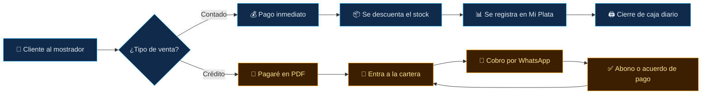

<div align="center">



**Sistema POS + Inventario para comercializadoras de insumos y reactivos químicos mineros**


</div>


## 📌 Tabla de contenidos

<div align="center">

| | | |
|:---:|:---:|:---:|
| 📖 [Acerca del proyecto](#-acerca-del-proyecto) | ✨ [Módulos principales](#-módulos-principales) | ⚡ [Flujo de una venta](#-flujo-de-una-venta) |
| 📸 [Vista previa](#-vista-previa) | 🧰 [Stack tecnológico](#-stack-tecnológico) | 💾 [Base de datos](#-base-de-datos) |
| 🚀 [Instalación](#-instalación-en-xampp) | 📂 [Estructura](#-estructura-del-proyecto) | 🧭 [Roadmap](#-roadmap) |
| 🤝 [Contribuir](#-contribuir) | 👤 [Autor](#-autor) | 📄 [Licencia](#-licencia) |

</div>

---

## 📖 Acerca del proyecto

> **MINERVOX** es una aplicación web *mobile-first* de **Punto de Venta (POS)**, diseñada a la medida para la comercialización de insumos y reactivos químicos mineros.

Centraliza las ventas de contado, el control de inventario de **sustancias controladas** y la administración de cartera (créditos o *"fiaos"*), automatizando la creación de pagarés en PDF y la comunicación con el cliente por WhatsApp.

| 🎯 Qué resuelve | Cómo lo hace |
|---|---|
| 📦 **Sustancias controladas** | Inventario en tiempo real con stock mínimo, kardex de movimientos y venta con cédula del cliente |
| 🧾 **Pagarés automatizados** | Vale de crédito, recibo, estado de cuenta y reportes en PDF al instante |
| 💰 **Gestión de cartera** | Semáforo de vencidos / por vencer / al día, abonos, acuerdos de pago y cobro por WhatsApp |
| 📊 **Control financiero** | “Mi Plata”: tablero, gastos, compras a proveedores y cierre de caja diario |
| 👥 **Multiusuario** | Roles `admin` y `cajero`, contraseñas con `password_hash()` y bloqueo por intentos fallidos |
| 📱 **Mobile-first** | Interfaz ágil para vender desde el mostrador, tablet o celular |

<div align="center">


</div>

---

## ✨ Módulos principales

<table>
<tr>
<td width="50%">

### 🛒 Facturación dual
Interfaz POS que alterna instantáneamente entre tarifas de **Contado** y **Crédito**, con carrito, descuentos y descuento automático de stock.

</td>
<td width="50%">

### 🔍 Clientes en caliente
Busca por **Cédula/NIT** y autocompleta los datos; permite editar o registrar clientes sin salir del flujo de venta.

</td>
</tr>
<tr>
<td width="50%">

### 🚦 Cartera con semáforo
Monitorea los plazos (**8 a 15 días**), registra abonos, firma acuerdos de pago y genera enlaces de cobro vía **WhatsApp**.

</td>
<td width="50%">

### 📊 Mi Plata (contabilidad)
Tablero de ingresos y utilidad, gastos por categoría, compras a proveedores, cuentas por pagar y **cierre de caja**.

</td>
</tr>
<tr>
<td width="50%">

### 📦 Inventario inteligente
Alertas preventivas al llegar al stock mínimo, productos controlados, inactivos y **kardex** de cada movimiento.

</td>
<td width="50%">

### 👥 Usuarios y roles
Área solo para **administrador**: crear cajeros, activar/desactivar, ver último acceso y bloqueo por intentos fallidos.

</td>
</tr>
<tr>
<td width="50%">

### 🖨️ Documentos en PDF
Pagarés, recibos, estado de cuenta, cartera general y cierre de caja listos para imprimir o enviar.

</td>
<td width="50%">

### ⚙️ Configuración del negocio
Datos de la empresa, plazos de crédito, tasas de mora, categorías y comportamiento de la interfaz.

</td>
</tr>
</table>

---

## ⚡ Flujo de una venta



---

## 📸 Vista previa

> 🎨 Maquetas ilustrativas de las tres pantallas principales — el diseño real se ajusta a cada dispositivo.

<div align="center">

**🛒 Punto de Venta**



_Alterna contado / crédito, busca con autocompletado y valida las sustancias controladas antes de cobrar._

**🚦 Semáforo de cartera**



_Tarjetas de vencidos, por vencer y al día, con barra de plazo, saldos y cobro en un clic._

**📄 Pagaré en PDF**



_Documento listo en segundos: datos del crédito, total, firma y envío por WhatsApp._

</div>

---

## 🧰 Stack tecnológico

<div align="center">

| Capa | Tecnologías |
|:---:|:---|
| 🎨 **Frontend** |      — Tailwind vía CDN, **Vue 3** para la reactividad, diseño mobile-first y  para íconos |
| ⚙️ **Backend** |  `POO` + `PDO` — sesiones, roles y consultas preparadas en **13 endpoints** |
| 🗄️ **Base de datos** |   — **17 tablas** + 2 vistas de utilidad |
| 📄 **Documentos** | `html2pdf.js` — recibos, pagarés, estado de cuenta y reportes en A4 |
| 🖥️ **Entorno** |  Apache + PHP + MariaDB, **sin Node.js ni npm** |

</div>

---

</details>

<details>
<summary><b>🧩 Errores frecuentes</b></summary>

| Síntoma | Solución |
|---|---|
| `PDOException: could not find driver` | Habilita la extensión `pdo_mysql` en `php.ini` de XAMPP y reinicia Apache |
| Página en blanco al abrir la app | Revisa `php_error.log` de XAMPP; casi siempre es la extensión `PDO` deshabilitada |
| Fecha u hora desfasadas | La zona horaria (**El Bagre, UTC-5**) se fija en `api/db.php`, no en `php.ini` |
| “Falta crear el administrador” | Aún no importaste `database.sql` + migraciones, o lo hiciste en otra base de datos |

</details>

> ⚠️ Requisitos: **XAMPP** (Apache + PHP 8+ + MySQL/MariaDB) con `PDO` habilitado.

---

## 📂 Estructura del proyecto

```
minervox-pos/
├── 📁 api/                        # 13 endpoints PHP (POO + PDO)
│   ├── 📄 db.php                  # Conexión PDO + zona horaria UTC-5
│   ├── 📄 auth.php                # Sesiones, roles y permisos
│   ├── 📄 sesion.php              # Entrar / salir / primer usuario
│   ├── 📄 ventas.php  cartera.php # Venta y créditos
│   └── 📄 ...                     # productos, clientes, compras, gastos, etc.
├── 📁 assets/
│   ├── 📄 app.js                  # Lógica de la interfaz (Vue 3)
│   ├── 📄 print_templates.js      # Plantillas e impresión en PDF
│   └── 📁 readme/                 # Imágenes animadas de este README
├── 📄 database.sql                # Esquema base (7 tablas)
├── 📄 migracion_minervox_v2..v5.sql
├── 📄 index.html                  # Punto de entrada de la aplicación
└── 📄 README.md
```

<details>
<summary><b>📡 Referencia rápida de la API</b></summary>

| Archivo | Responsabilidad |
|---|---|
| `sesion.php` | Único endpoint accesible sin sesión: estado, login, logout y primer administrador |
| `auth.php` | Exige sesión y permisos; distingue `admin` de `cajero` |
| `usuarios.php` | Alta/baja de usuarios, roles y contraseñas (solo admin) |
| `ventas.php` | Registra la venta y congela el costo real de cada producto |
| `cartera.php` | Resumen del semáforo, deudores, abonos, acuerdos y estado de cuenta |
| `clientes.php` | Clientes por cédula/NIT |
| `productos.php` | Productos, stock mínimo y controlados |
| `compras.php` | Compras a proveedores, cuentas por pagar y pagos |
| `proveedores.php` | Directorio de proveedores |
| `gastos.php` | Gastos por categoría |
| `cierres_caja.php` | Arqueo y cierre de caja del día |
| `contabilidad.php` | “Mi Plata”: tablero y reportes (solo lectura) |
| `configuracion.php` | Datos del negocio, plazos y tasas |
| `db.php` · `utilidades.php` | Conexión PDO y helpers compartidos |

</details>

---

## 🧭 Roadmap


- [x] Módulo de facturación (Contado/Crédito)
- [x] Generador de pagarés en PDF
- [x] Buscador de clientes por Cédula/NIT
- [x] Dashboard de reportes y estadísticas de ventas (“Mi Plata”)
- [x] Cartera con semáforo, mora y acuerdos de pago
- [x] Roles y permisos multiusuario
- [ ] Sustancias controladas: exigir cédula al vender
- [ ] Anulación de ventas
- [ ] Notificaciones automáticas por WhatsApp API
- [ ] Modo offline completo (Service Workers)

---

## 🤝 Contribuir

¡Las contribuciones son bienvenidas! 🎉

1. Haz un **Fork** del proyecto
2. Crea tu rama: `git checkout -b feature/nueva-funcionalidad`
3. Haz **commit** de tus cambios: `git commit -m "Agrega nueva funcionalidad"`
4. Sube tu rama: `git push origin feature/nueva-funcionalidad`
5. Abre un **Pull Request**

---

## 👤 Autor

<div align="center">

**luis06-op**


<br>

[](https://github.com/luis06-op)
[](https://github.com/luis06-op)

</div>

---

## 📄 Licencia

Este proyecto está bajo la Licencia **MIT** — consulta el archivo [`LICENSE`](LICENSE) para más detalles.

<div align="center">


### ⛏️ Hecho con dedicación para optimizar la gestión minera ⛏️

[](https://github.com/luis06-op)

</div>
